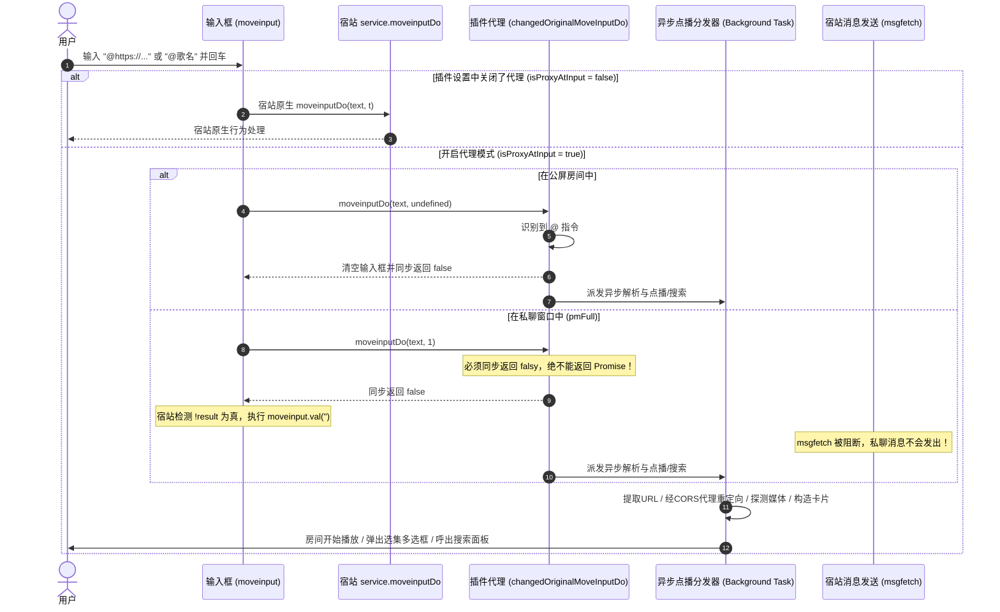
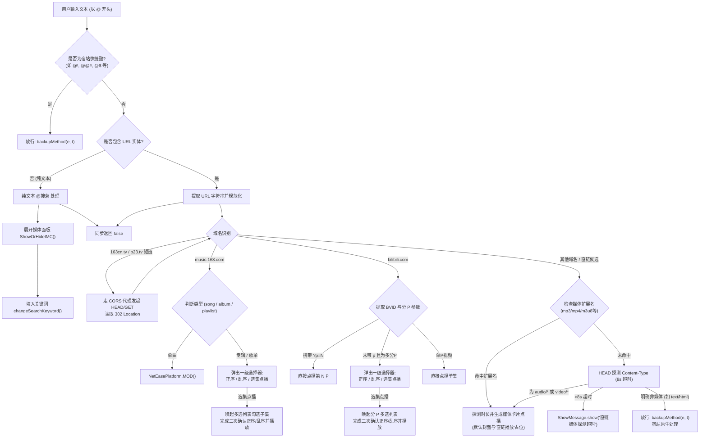

# 输入框拦截与解析流程 (Interception & Resolution Flow)

本文档通过时序图与流程图呈现输入框 `@` 事件拦截、私聊防泄露同步契约以及后台异步解析流水线。

## 1. 私聊与公屏输入拦截时序图 (Private Chat vs Room Flow)

---

## 2. 链接解析与分发流程图 (Link Parsing & Dispatch Flowchart)

