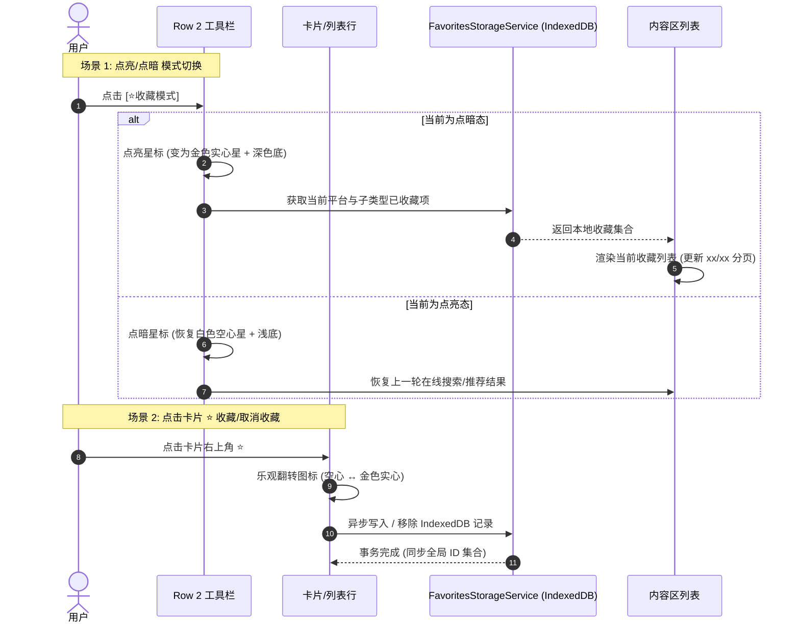

# 收藏交互与视觉规范 (interaction-specs.md)

## 1. 收藏星标 (Star Icon) 视觉规范

### 1.1 自包含图标与字体定义 (`src/app.css`)
遵循项目自包含图标规范，严禁借用宿站未知样式：
- **未收藏态 / 点暗态 (Star Outline)**:
  - MDI 码点：`\F04CF` (`star-outline`)
  - 样式：默认半透明柔和灰色或半透白色，背景 `bg-[#fff3]`。
- **已收藏态 / 点亮态 (Star Solid)**:
  - MDI 码点：`\F04CE` (`star`)
  - 样式：明亮金黄色（`#fbc02d`），高饱和对比度，背景 `bg-[#00000080]`。

```css
/* src/app.css 中的自包含图标注入 */
.starOutlineIcon::before {
  content: "\F04CF";
  font-family: "md";
}

.starSolidIcon::before {
  content: "\F04CE";
  font-family: "md";
}
```

---

## 2. Row 2 工具栏「收藏模式」双态切换键设计

### 2.1 排序与视觉结构
严格遵循水平视觉操作流向：
`[卡片/列表] [⭐收藏模式]   [🔍 搜索]   [xx/xx]   [上一页] [下一页]`

```
┌──────────────────────────────────────────────────────────────────────────────────┐
│  [卡片/列表]  [⭐模式切换]       [🔍 搜索框]         [xx/xx]     [上一页]  [下一页] │
│   (44×44px)   (44×44px)        (自适应弹性)       (纯文字指示)  (48×44px) (48×44px)│
└──────────────────────────────────────────────────────────────────────────────────┘
```

### 2.2 点亮与点暗状态定义

| 状态 | 视觉样式 | 图标与颜色 | Tooltip / 描述 | 页面内容状态 |
| :--- | :--- | :--- | :--- | :--- |
| **点暗态 (Dimmed)** | `bg-[#fff3] rounded-full max-[768px]:rounded-lg` | `.starOutlineIcon`，白色半透 | `当前:全网发现,点击切换到收藏模式` | 展示当前平台的**在线搜索与推荐内容** |
| **点亮态 (Lit Up)** | `bg-[#00000080] rounded-full max-[768px]:rounded-lg shadow-[0_0_8px_rgba(251,192,45,0.3)]` | `.starSolidIcon`，明亮金色 (`#fbc02d`) | `当前:我的收藏,点击切回全网发现` | 下方无缝切换为**当前平台下的已收藏条目** |

- **触控反馈**：点击瞬间触发 `active:scale-95 transition-all duration-100` 弹性触控反馈。

---

## 3. 卡片与列表行的收藏触发按钮 (Star Action)

### 3.1 卡片视图 (Card View) 悬浮触控药丸
- **位置**：位于卡片右上角（`absolute top-2 right-2 z-10`）；
- **尺寸**：`36×36px` 圆形触控区；
- **背景**：`bg-black/40 backdrop-blur-[6px]` 磨砂玻璃圆底；
- **状态**：
  - 未收藏：暗白色空心星 `.starOutlineIcon`；
  - 已收藏：金色实心星 `.starSolidIcon`；
  - 点击时：触发轻微回弹缩放（`scale-110 active:scale-90`）。

### 3.2 列表视图 (List Row) 紧凑操作按钮
- **位置**：位于列表行右侧，紧邻播放/选集按钮组左侧；
- **规格**：移动端 `40×56px` 触控块，图标 `22px` 居中；
- **状态**：未收藏为暗灰色，已收藏为金色高亮实心星。

---

## 4. 交互流转与体验细节



### 4.1 乐观 UI 更新 (Optimistic UI)
- 点击卡片上的 ⭐ 时，图标零延迟立刻切换，不等待 IndexedDB 事务提交；

### 4.2 收藏模式下的取消收藏交互
- 当在收藏模式下点击已收藏项的 ⭐ 时：
  - 星标变灰（空心），弱提示「已取消收藏」；
  - 该卡片在当前屏幕**保持温和保留态（不立即瞬间消失）**，避免用户手滑误触而无法撤回；当用户切换分类标签、翻页或下一次打开时完成清理。
